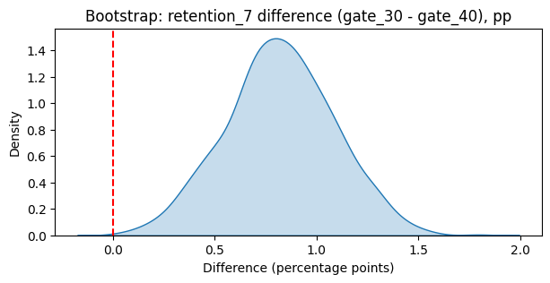

# Mobile Game A/B Test: Does Moving the Progress Gate Hurt Retention?

## Business Question
Cookie Cats tested moving its first progress gate from level 30 to level 40. Did this change player retention, and should the change be shipped?

## Data
- 90,189 players randomly assigned to `gate_30` (control) or `gate_40` (test)
- Columns: `userid`, `version`, `sum_gamerounds` (first 14 days), `retention_1`, `retention_7`
- Source: [Kaggle - Mobile Games A/B Testing: Cookie Cats](https://www.kaggle.com/datasets/mursideyarkin/mobile-games-ab-testing-cookie-cats) (download and place `cookie_cats.csv` in `data/`)

## Approach
1. **Data quality:** checked nulls/duplicates; removed 1 impossible outlier (49,854 rounds in 14 days)
2. **Sample Ratio Mismatch check:** chi-square test on group sizes
3. **EDA:** engagement distribution and retention by group
4. **SQL segmentation (DuckDB):** engagement segments with window functions and weighted contribution analysis
5. **Hypothesis testing:** two-proportion z-tests (alpha = 0.05)
6. **Bootstrap:** 1,000 resamples for assumption-free 95% confidence intervals
7. **Business impact:** translated the effect into lost retained players

## Key Findings

| Metric | gate_30 | gate_40 | Diff | p-value | Bootstrap 95% CI |
|---|---|---|---|---|---|
| Day-1 retention | 44.82% | 44.23% | 0.59 pp | 0.074 | [-0.04, 1.20] pp |
| Day-7 retention | 19.02% | 18.20% | **0.82 pp** | **0.0016** | **[0.30, 1.33] pp** |

- Moving the gate to level 40 **significantly reduced 7-day retention by 0.82 pp (4.3% relative drop)**.
- About 75% of the gap comes from players with 40-99 rounds, the group that hits the level-40 gate in the test version.
- Heavy players (100+ rounds) were unaffected (71.1% vs 71.0%).
- Business impact: about 8,200 fewer day-7 retained players per 1M installs (range 3,000 to 13,300).

## Recommendation
**Do not ship gate_40. Keep the gate at level 30.** An earlier gate likely forces a break that reduces burnout and keeps players returning.

## Limitations
- Sample ratio mismatch detected (49.6% / 50.4%, p = 0.0085); randomization should be audited
- No revenue data; monetization impact is inferred
- 14-day window only
- Segment analysis uses a post-treatment variable and is descriptive, not causal

## Next Steps
Audit randomization, add revenue data, test an intermediate gate (level 35), track 30-day retention.

## Tools
Python (pandas, NumPy), SQL (DuckDB), statsmodels, SciPy, Matplotlib, Seaborn, Jupyter